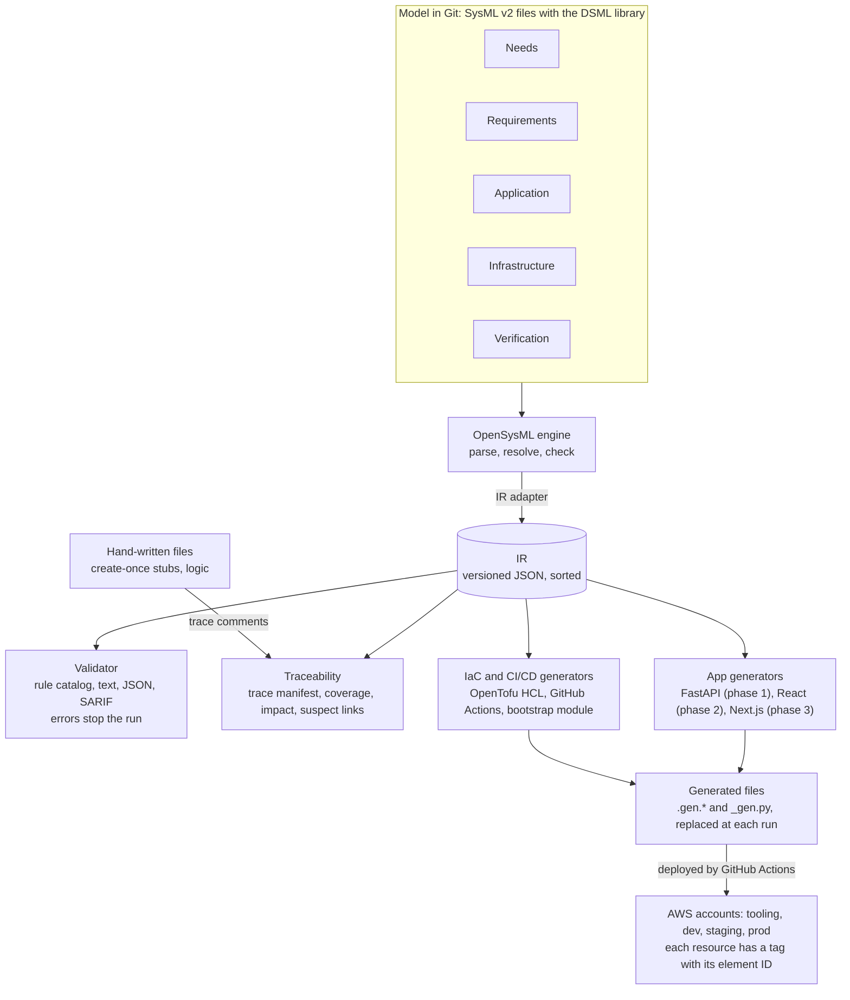

# DSML toolchain: top-level PRD

Status date: 10 October 2026

## Summary

With the DSML toolchain, a team keeps stakeholder needs, requirements, application structure and AWS infrastructure in one SysML v2 model, and generates deterministic code from that model. The toolchain is an internal product. Phase 1 delivers the model, validation, traceability, FastAPI code, OpenTofu code and GitHub Actions pipelines.

The toolchain has five functions:

1. It extends SysML v2 with a domain-specific modeling language (DSML) for needs, requirements, application, infrastructure and verification.
2. It generates application code for React, Next.js or FastAPI.
3. It generates infrastructure code for OpenTofu and Terraform, and CI/CD pipelines for GitHub Actions.
4. It validates the model before it generates code.
5. It traces each stakeholder need to requirements, code, tests and AWS resources.

This PRD gives the goals, users, architecture, phases and cross-cutting requirements. Seven more PRDs give the requirements for each part (see Document map). [DSML decision record 01: scope and architecture](../decisions/dr-01-scope-and-architecture.md) and [DSML decision record 02: generated code, integration and PRD set](../decisions/dr-02-generated-code-integration-and-prd-set.md) are the decision baseline.

## Goals

The product has five goals. Each goal is a product need with an ID, so the DSML appendix can trace each PRD requirement to a goal.

| ID | Goal | Measure of success |
| --- | --- | --- |
| N-001 | One model holds the needs, requirements, application structure, infrastructure and verifications of a product, with links between them. | A product team keeps all five layers in `.sysml` files in one Git repository. |
| N-002 | Code generation is deterministic. | The same model, generator version and configuration give byte-identical output on Linux and macOS. |
| N-003 | The model is correct before code generation starts. | Validation finds each model error that the rule catalog defines, and code generation stops if there is an error. |
| N-004 | Each requirement traces to the code, infrastructure and tests that cover it. | The coverage matrix shows the status of each requirement, and each AWS resource has a tag with its model element ID. |
| N-005 | The model does not depend on one cloud provider. | The logical infrastructure layer contains no AWS term. A second cloud needs only a new realization layer. |

## Users

Three roles use the toolchain. Each role owns one or more model layers and reads the reports of the other layers.

| Role | Owns in the model | Main tasks | Main outputs |
| --- | --- | --- | --- |
| Systems engineer | Stakeholders, needs, requirements, verifications | Writes needs and requirements. Links requirements to needs. Reviews coverage and suspect links. | Coverage matrix, orphan report, impact analysis |
| Software developer | Application layer: entities, operations, views, roles | Models the application. Generates code. Writes business logic in hand-written files. Adds trace comments. | Application code, Dockerfiles, trace manifest |
| Platform engineer | Infrastructure layer: logical elements, AWS realizations, environments, accounts | Models the infrastructure. Generates OpenTofu code and pipelines. Starts the AWS accounts with the bootstrap module. | OpenTofu code, GitHub Actions workflows |

CI is a fourth user. It runs validation, the determinism check and the deployments with no person present.

## Architecture

OpenSysML parses the model, and the IR adapter writes the IR. Only the IR reaches the validator, the traceability engine and the generators. The generators write generated files and create-once stubs. The generated pipelines deploy the result to the AWS accounts.

## Phases

Phase 1 delivers a full path from model to a running FastAPI service in AWS. Phases 2 and 3 add the two TypeScript targets. Each phase ends when a reference model passes its exit criteria.

| Phase | Contents | Exit criteria |
| --- | --- | --- |
| 1 | DSML library with all five layers. OpenSysML integration, IR, CLI and GitHub Action. Validation and traceability. FastAPI generator. Infrastructure generator for the network, container service, database, user directory and secrets. GitHub Actions generator. | The reference model "order service" (one FastAPI application, PostgreSQL, Cognito) deploys to the dev account through the generated pipeline. The determinism check passes on Linux and macOS. The coverage matrix shows each reference requirement as satisfied and verified. |
| 2 | React generator with FSD. Infrastructure for the static site (S3, CloudFront, ACM, Route 53). Import of an external OpenAPI file. | The reference model with a React application and a FastAPI application deploys to dev. The generated React code passes `tsc` and the FSD linter. |
| 3 | Next.js generator with FSD. | The reference model with a Next.js application deploys to dev. |

These items are out of scope for phases 1 to 3: the VS Code extension with a language server (Q5), import from a Systems Modeling API server (Q9), behavior generation (Q14), test generation (Q13), a second cloud provider (Q20) and validation rules as SysML v2 constraints (Q26).

## Document map

The PRD set has this top-level PRD and seven PRDs. Four decision records hold the decisions that the PRDs come from.

| Document | ID prefix | Scope | Phase |
| --- | --- | --- | --- |
| Top-level PRD (this document) | PRD-TOP | Goals, users, architecture, phases, conventions, cross-cutting requirements, project dictionary, DSML appendix | 1 to 3 |
| [DSML PRD: modeling language](01-dsml-prd.md) | PRD-DSML | DSML library and the five model layers | 1 |
| [Toolchain core PRD: CLI, IR and determinism](02-toolchain-core-prd.md) | PRD-CORE | CLI, configuration, OpenSysML integration, IR, determinism, generated files, packaging | 1 |
| [Application generation PRD: FastAPI, React, Next.js](03-application-generation/00-common-rules.md) | PRD-APP | Rules for all targets, then FastAPI, React and Next.js, one file each | 1 to 3 |
| [Infrastructure generation PRD: OpenTofu and Terraform](04-infrastructure-generation-prd.md) | PRD-IAC | HCL output, AWS resources, environments, accounts, security baseline, tags | 1 |
| [CI/CD generation PRD: GitHub Actions](05-cicd-generation-prd.md) | PRD-CICD | GitHub Actions workflows, AWS access, deployment steps | 1 |
| [Validation PRD: rules and findings](06-validation-prd.md) | PRD-VAL | Rule engine, output formats, waivers, rule catalog | 1 |
| [Traceability PRD: links, manifests and reports](07-traceability-prd.md) | PRD-TRACE | Link types, trace manifest, trace comments, reports | 1 |
| [DSML decision record 01: scope and architecture](../decisions/dr-01-scope-and-architecture.md) | Q1 to Q33, AD1 to AD3 | Scope and architecture | Closed |
| [DSML decision record 02: generated code, integration and PRD set](../decisions/dr-02-generated-code-integration-and-prd-set.md) | Q34 to Q48 | Generated code layout, integration, PRD set | Closed |
| [DSML decision record 03: versions and PRD details](../decisions/dr-03-versions-and-prd-details.md) | Q49 to Q56 | Version baseline and PRD details | Closed |
| [DSML decision record 04: formal constraints and the AWS test schedule](../decisions/dr-04-formal-constraints-and-aws-test-schedule.md) | Q57 to Q58 | Formal constraint results in the IR, schedule of the AWS deployment tests | Closed |
| [DSML decision record 05: DSML library keywords and the pilot check](../decisions/dr-05-dsml-library-keywords-and-pilot-check.md) | Q59 to Q60 | Keywords that specialize `SemanticMetadata`, check of the library with the OMG pilot implementation | Closed |
| [DSML decision record 06: self-contained requirement text](../decisions/dr-06-self-contained-requirement-text.md) | Q61 | References from a requirement to a table, a tree or a catalog of its PRD | Closed |

The [DSML appendix](../model/README.md) holds all PRD requirements as a DSML model (Q48).

## Conventions

All documents of the PRD set use the same language, IDs and table form.

- **Language.** The text uses ASD-STE100 Simplified Technical English, Issue 9. The project dictionary below gives the approved technical nouns and technical verbs.
- **Modal verbs.** "Must" marks an obligation. "Can" marks a possibility or a permission. The documents do not use "shall", "should" or "may".
- **Requirement IDs.** Each requirement has the ID `PRD-<PART>-<NNN>`, for example `PRD-CORE-012`. `<PART>` is the prefix of the PRD. `<NNN>` has three digits. A deleted ID is not used again.
- **Requirement tables.** Each requirement table has four columns: ID, Requirement, Verification and Source. Source gives the decisions (Q1 to Q61, AD1 to AD3) that the requirement comes from.
- **Goals.** The lead of each PRD gives the goals (N-001 to N-005) that its requirements cover.
- **Phase.** The lead of each PRD gives its phase. A requirement for a different phase states that phase in its text.
- **Verification methods.**
  - Test: an automatic test in the CI of the toolchain.
  - Inspection: a person examines a document, a file or a generated output.
  - Analysis: a calculation or a comparison of data, for example a measurement of run time.
  - Demonstration: a person runs the toolchain and examines the result.

## Cross-cutting requirements

These requirements apply to all parts of the toolchain and to all PRDs. They cover goals N-001 to N-005.

| ID | Requirement | Verification | Source |
| --- | --- | --- | --- |
| PRD-TOP-001 | The toolchain must be written in Python, and uv must manage the Python project. | Inspection | Q8 |
| PRD-TOP-002 | The toolchain must install as one Python package that supplies the command `dsml`. | Demonstration | Q5 |
| PRD-TOP-003 | The toolchain must run on the operating systems that decision record 03 gives. | Test | Q50 |
| PRD-TOP-004 | Validation, code generation and traceability must not use an AI model. | Inspection | Q16 |
| PRD-TOP-005 | Validation, code generation and trace reports must not use the network. Only the local OpenSysML child process is permitted. | Test | Q16, Q38 |
| PRD-TOP-006 | The toolchain must not write a secret value to a log, a report or a generated file. | Test | Q43 |
| PRD-TOP-007 | Each dependency of the toolchain and of the generated code must have a license that the company accepts for internal software. | Inspection | Q4 |
| PRD-TOP-008 | Generated code must pin each dependency to the exact version that the version baseline gives. | Inspection | Q17, Q49 |
| PRD-TOP-009 | The PRD set and the user documentation of the toolchain must use ASD-STE100 Issue 9. | Inspection | Q1 |
| PRD-TOP-010 | Each PRD requirement must have a unique ID with the prefix of its PRD. | Inspection | Q32 |
| PRD-TOP-011 | The DSML appendix must contain each PRD requirement. OpenSysML must parse the appendix with no error. | Test | Q48 |
| PRD-TOP-012 | Validation and code generation of a model with 1,000 elements must finish in the time that decision record 03 gives. | Analysis | Q50 |

## Project dictionary

The PRD set can use these words in addition to the STE dictionary. Each term has one meaning. Product names (for example OpenSysML, FastAPI, Amazon Cognito) and code names in `code` font are also permitted.

| Term | Type | Meaning |
| --- | --- | --- |
| application | Technical noun | One deployable unit in the model, with one target. |
| baseline | Technical noun | A Git commit that the toolchain compares with the current model. |
| create-once file | Technical noun | A file that the generator writes only if it does not exist. After that, a developer owns it. |
| DSML | Technical noun | The domain-specific modeling language of this product: the SysML v2 library package `DSML`. |
| element | Technical noun | One item in the model, for example a need, an entity or an environment. |
| entity | Technical noun | A data type in the application layer that the generator maps to a table, types and schemas. |
| environment | Technical noun | One deployment of the infrastructure: dev, staging or prod. |
| finding | Technical noun | One result of a validation rule: rule ID, severity, message, location. |
| generated file | Technical noun | A file that the generator writes and deletes. Its name ends with `.gen.<ext>` or `_gen.py`. |
| hand-written file | Technical noun | A file that a developer writes. The generator never changes it. |
| IR | Technical noun | Intermediate representation: the versioned JSON form of the model that validators and generators read. |
| layer | Technical noun | (1) One of the five parts of the model: need, requirement, application, infrastructure, verification. (2) An FSD layer. The text always states which. |
| manifest | Technical noun | A JSON file that lists generated files or trace data. |
| need | Technical noun | A stakeholder concern in the model, with an ID such as `N-001`. |
| operation | Technical noun | An API action of an application: a CRUD action or a custom action. |
| pipeline | Technical noun | A GitHub Actions workflow that the generator writes. |
| realization | Technical noun | The AWS form of a logical infrastructure element. |
| requirement | Technical noun | A requirement element in the model, with an ID such as `R-001`, or a PRD requirement. |
| role | Technical noun | A named set of permissions in the application layer. |
| rule | Technical noun | One validation check with an ID, a severity and a message. |
| slice | Technical noun | An FSD slice, or a vertical slice of a FastAPI application. |
| stakeholder | Technical noun | A person or group that has needs. |
| suspect link | Technical noun | A trace link with an end that changed after the baseline. |
| target | Technical noun | The framework that the generator writes code for: React, Next.js or FastAPI. |
| trace link | Technical noun | A relationship from one element to a different element or to a file. |
| verification | Technical noun | A verification element with an ID such as `V-001`, which shows how a requirement is verified. |
| view | Technical noun | A UI page in the application layer: list, detail or form. |
| waiver | Technical noun | An annotation that stops one rule for one element, with a reason and an owner. |
| build | Technical verb | To compile and package code. |
| commit | Technical verb | To record a change in Git. |
| deploy | Technical verb | To put a build into an environment. |
| generate | Technical verb | To write files from the IR with the generator. |
| lint | Technical verb | To examine code with a static analysis tool. |
| parse | Technical verb | To read model text into a syntax tree. |
| pin | Technical verb | To set one exact version or commit SHA. |
| promote | Technical verb | To deploy the same build to the next environment. |
| push | Technical verb | To send commits or a container image to a remote store. |
| trace | Technical verb | To find the elements and files that a link connects. |
| validate | Technical verb | To examine the model with the validation rules. |
