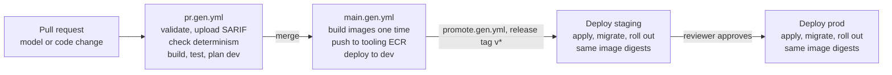

# CI/CD generation PRD: GitHub Actions

Status date: 10 October 2026

## Summary

The pipeline generator writes GitHub Actions workflows that validate the model, check determinism, build each application, and deploy the same build to dev, staging and prod. CI uses short-term AWS credentials through GitHub OIDC.

- **Phase:** 1. The static site steps are in phase 2.
- **Goals covered:** N-002 (deterministic generation) and N-003 (correct model).
- **Prefix:** PRD-CICD.
- **Related PRDs:** the infrastructure PRD writes the IAM roles, the state buckets and the outputs that the workflows use. The toolchain core PRD supplies the GitHub Action that runs `dsml`.

## Pipeline flow

A pull request runs the checks. A merge builds the images one time and deploys them to dev. A release tag promotes the same digests to staging, and prod needs a reviewer.

## Workflows and jobs

The generator writes three workflows. Each workflow file name ends with `.gen.yml`, so hand-written workflows can stay beside them.

| Workflow | Trigger | Jobs |
| --- | --- | --- |
| `pr.gen.yml` | Pull request | Validate the model, check determinism, build and test each application, check the output, plan dev |
| `main.gen.yml` | Push to the main branch | Build and push the images and static files, deploy to dev |
| `promote.gen.yml` | Release tag `v*`, or a manual run with a main build as input | Deploy the same build to staging, then to prod |

| ID | Requirement | Verification | Source |
| --- | --- | --- | --- |
| PRD-CICD-001 | The generator must write `.github/workflows/pr.gen.yml`, `main.gen.yml` and `promote.gen.yml` with the triggers and jobs in the table of the section "Workflows and jobs". | Test | Q43, Q61 |
| PRD-CICD-002 | `pr.gen.yml` must run `dsml validate` and upload the SARIF findings to GitHub code scanning. | Test | Q28, Q43 |
| PRD-CICD-003 | `pr.gen.yml` must run `dsml generate --check` and fail if a generated file is different from the committed file. | Test | Q16, Q43 |
| PRD-CICD-004 | For each application, `pr.gen.yml` must install the dependencies from the committed lockfile (`uv sync --frozen` or `pnpm install --frozen-lockfile`), then run the linter, the type checker and the tests. A lockfile that does not agree with the dependency list must make the job fail. | Test | Q16, Q43 |
| PRD-CICD-005 | `pr.gen.yml` must run `dsml check-output`. | Test | Q28 |
| PRD-CICD-006 | `pr.gen.yml` must run `tofu plan` for dev with the plan role, and write the plan text in the job summary. It must not apply. | Test | Q43 |
| PRD-CICD-007 | `main.gen.yml` must build each container image and the static files of each React application one time. It must then deploy them to dev. | Test | Q43 |
| PRD-CICD-008 | `promote.gen.yml` must deploy the image digests and the static files of one main build to staging, then to prod. It must not build again. | Test | Q43 |
| PRD-CICD-009 | Each deploy job must use a `concurrency` group for its environment, so only one deployment runs in an environment at a time. A new run must not cancel a running deployment. | Test | Q43 |

## AWS access and workflow security

Workflows get AWS credentials only through GitHub OIDC, with one role for each purpose and environment. Prod deployments need an approval from a person.

| ID | Requirement | Verification | Source |
| --- | --- | --- | --- |
| PRD-CICD-010 | Workflows must get AWS credentials only through GitHub OIDC and the roles of PRD-IAC-027 and PRD-IAC-028. They must not use long-term access keys. | Test | Q43 |
| PRD-CICD-011 | Each job must declare the smallest `permissions` set that it needs. Only jobs that use AWS must have `id-token: write`. | Test | Q43 |
| PRD-CICD-012 | Each deploy job must use the GitHub environment of its target environment (`dev`, `staging` or `prod`). | Test | Q43 |
| PRD-CICD-013 | The generator must write a README with the settings that a repository administrator must make: the GitHub environments, required reviewers for `prod`, and branch protection for the main branch. | Inspection | Q43 |
| PRD-CICD-014 | Each third-party action must be pinned to a full commit SHA from the version baseline, with its version in a comment. | Test | Q43, Q49 |
| PRD-CICD-015 | Workflows must not write secret values to logs or job summaries. Values from AWS outputs that are not secret can appear in summaries. | Test | PRD-TOP-006 |

## Deployment steps

In each environment, a deploy job applies the infrastructure, runs the database migrations, and only then moves the services to the new image.

| ID | Requirement | Verification | Source |
| --- | --- | --- | --- |
| PRD-CICD-016 | A deploy job must run `tofu apply` with the image digests of the build and `model_commit` set to the commit of the build. | Test | Q30, Q43 |
| PRD-CICD-017 | After the apply, the job must run the migration task definition of each application with a database as a one-off ECS task, and wait for it. If the task fails, the job must stop before it changes a service. | Test | Q53 |
| PRD-CICD-018 | After the migrations, the job must set each ECS service to its new task definition and wait for a steady state. If the ECS deployment circuit breaker rolls back, the job must fail. | Test | Q53, PRD-IAC-042 |
| PRD-CICD-019 | Phase 2: for each React application, the job must upload the static files to its S3 bucket, write `/config.json` from the outputs of the root module, and invalidate the CloudFront cache. | Test | Q43, PRD-APP-230 |
| PRD-CICD-020 | `promote.gen.yml` must deploy to prod only after the staging deployment of the same build succeeded and a required reviewer approved the `prod` environment. | Test | Q43 |
| PRD-CICD-021 | Each deploy job must write a job summary with the environment, the image digests, the model commit and the applied migrations. | Test | Q30 |
