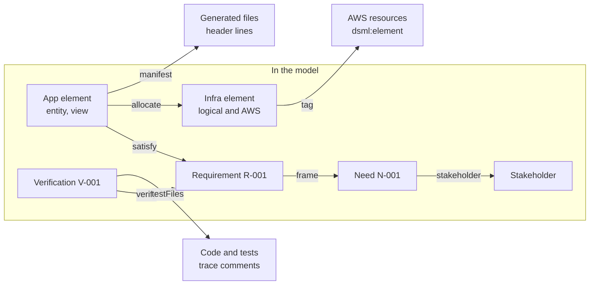

# Traceability PRD: links, manifests and reports

Status date: 10 October 2026

## Summary

Traceability connects each stakeholder need to its requirements, the application and infrastructure elements that satisfy them, the generated files, the hand-written code, the tests and the AWS resources. SysML v2 relationships carry the links in the model. A trace manifest, trace comments and AWS tags carry them outside the model.

- **Phase:** 1.
- **Goals covered:** N-004 (traceability) and N-001 (one model with links).
- **Prefix:** PRD-TRACE.
- **Related PRDs:** the validation PRD has the coverage rules (category COV). The infrastructure PRD writes the AWS tags.

## Link types



Arrows point from the source of each link to its target. Inside the model, SysML v2 relationships carry the links. Outside the model, the trace manifest, the `testFiles` attribute, trace comments and AWS tags carry them. Requirement derivation and refinement connect two requirements, and `#Realizes` connects an AWS realization to its logical element.

| ID | Requirement | Verification | Source |
| --- | --- | --- | --- |
| PRD-TRACE-001 | The model must use these link types: the `stakeholder` member of a need, `frame`, `#derivation`, `#refinement`, `satisfy`, `allocate`, `#Realizes` and `verify`. | Test | Q29 |
| PRD-TRACE-002 | A `satisfy` link can come from an application element or from an infrastructure element. | Test | Q29 |
| PRD-TRACE-003 | The IR must hold each link with its type and the identities of its source and target. | Test | Q29, PRD-CORE-024 |
| PRD-TRACE-004 | The traceability engine must follow links in the two directions: from a need to its code, tests and AWS resources, and from a file or resource back to its needs. | Test | Q29, N-004 |

## Trace into generated code and HCL

Each generated source file names its model elements in a header. A trace manifest gives the full map from elements to files and symbols, so a person or a tool can find the code of each element without the network.

```text
# Generated by dsml 1. Do not edit.
# Elements: OrderService::CancelOrder, OrderService::Order, R-001
```

| ID | Requirement | Verification | Source |
| --- | --- | --- | --- |
| PRD-TRACE-005 | Each generated source file that permits comments must start with a header: the line `Generated by dsml <major>. Do not edit.`, then the line `Elements:` with the identities of its model elements in sorted order. | Test | Q30, PRD-CORE-038 |
| PRD-TRACE-006 | The generator must write the trace manifest `.dsml/trace.gen.json`. For each element, it must give each generated file, each symbol in that file (class, function, route or HCL resource address) and the line range of the symbol. | Test | Q30 |
| PRD-TRACE-007 | The trace manifest must give the HCL resource addresses of each infrastructure element, so a person can find the AWS resources of an element from its `dsml:element` tag or from its address. | Test | Q30, PRD-IAC-035 |
| PRD-TRACE-008 | The trace manifest must be sorted by element identity, then by file path, then by line. | Test | Q16 |

## Trace comments in hand-written code

Developers connect hand-written code and tests to the model with one comment form. The toolchain reads these comments and adds them to the reports.

```python
# trace: R-001, V-001
async def handle(input: CancelOrderInput, session: AsyncSession, user: User) -> Order:
    ...
```

| ID | Requirement | Verification | Source |
| --- | --- | --- | --- |
| PRD-TRACE-009 | A trace comment must be a line comment with the form `trace: <ID>[, <ID>]`: `# trace: R-001` in Python, HCL and YAML, and `// trace: R-001` in TypeScript. An ID can be a short name or a qualified name. | Test | Q30 |
| PRD-TRACE-010 | The toolchain must read trace comments in the hand-written files of the output folders and of the test folders in the configuration file. It must not read generated files for trace comments. | Test | Q30 |
| PRD-TRACE-011 | A trace comment applies to the next symbol in the file. If no symbol follows, it applies to the file. | Test | Q30 |
| PRD-TRACE-012 | The orphan report must list each trace comment with an ID that is not in the model. | Test | Q31 |

## Reports

`dsml trace` writes four reports. Impact analysis and suspect links compare the model with a Git baseline.

| Report | Question it answers | Content |
| --- | --- | --- |
| `coverage` | Is each requirement covered? | One row for each requirement: framed needs, satisfying elements, generated files, trace comments, verifications, status |
| `orphans` | What has no link? | Needs with no requirement, requirements with no need, elements that satisfy no requirement, trace comments with unknown IDs, test files that no verification names |
| `impact` | What does a change affect? | For each element that changed after the baseline: the affected needs, requirements, verifications, generated files and HCL addresses |
| `suspect` | Which links need a review? | Each link with an end that changed after the baseline |

| ID | Requirement | Verification | Source |
| --- | --- | --- | --- |
| PRD-TRACE-013 | `dsml trace` must write the four reports `coverage`, `orphans`, `impact` and `suspect` in the table of the section "Reports". | Test | Q31, Q61 |
| PRD-TRACE-014 | The coverage report must give each requirement one status: `missing` (no satisfying element), `satisfied` (a satisfying element, no verification) or `verified` (a satisfying element and a verification). | Test | Q31 |
| PRD-TRACE-015 | An element must count as changed if the hash of its IR form, with no source locations, is different from the hash in the baseline. | Test | Q31 |
| PRD-TRACE-016 | The `impact` and `suspect` reports must use the baseline that `--baseline` gives, or the default baseline that decision record 03 gives. | Test | Q31, Q54 |
| PRD-TRACE-017 | Each report must be available as HTML, CSV and JSON. The HTML report must be one file with no external resources. | Test | Q31 |
| PRD-TRACE-018 | Each report must give the model commit and the baseline commit, and no date or time. | Test | Q16, Q31 |
