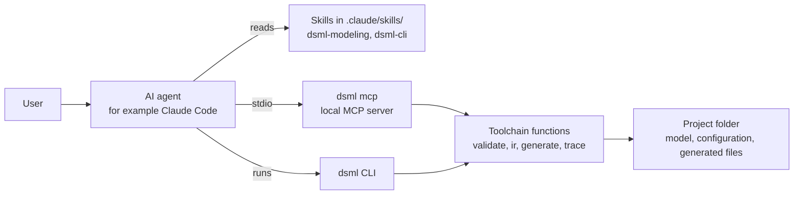

# AI assistance PRD: skills and MCP server

Status date: 12 October 2026

## Summary

AI agents can help the users of the toolchain. Two skills tell an agent how to write DSML models and how to use the `dsml` CLI. A local MCP server gives an agent the same functions as MCP tools, MCP resources and MCP prompts. [DSML decision record 10: AI assistance and user guide](../decisions/dr-10-ai-assistance.md) gives the decisions.

- **Phase:** 4.
- **Goals covered:** N-003 (a correct model) and N-001 (one model with links).
- **Prefix:** PRD-AI.
- **Related PRDs:** the toolchain core PRD gives the commands that the skills and the MCP tools use. The validation PRD gives the rule catalog.

## The toolchain does not use an AI model

PRD-TOP-004 and PRD-TOP-005 stay true. The AI agent is a client of the toolchain, not a part of it. The skills are text files that the agent reads. The MCP server runs the same functions as the CLI, on the computer of the user. Validation, code generation and trace reports use no AI model and no network.

## Skills

Each skill is a folder in the Agent Skills format: a `SKILL.md` file and reference files. The toolchain package contains the skills, so they always agree with the installed `dsml` version (Q68).

| Skill | What it tells the agent |
| --- | --- |
| `dsml-modeling` | The five model layers, the DSML keywords, the rule catalog and example models. |
| `dsml-cli` | The commands `dsml init`, `validate`, `generate`, `check-output` and `trace`, and the loop that corrects findings. |

| ID | Requirement | Verification | Source |
| --- | --- | --- | --- |
| PRD-AI-001 | The toolchain package must contain two skills in the Agent Skills format: the modeling skill `dsml-modeling` and the CLI skill `dsml-cli`. | Inspection | Q68 |
| PRD-AI-002 | The modeling skill must tell an AI agent how to write a model in the five layers with the DSML keywords. It must contain the rule catalog and example models. | Inspection | Q68 |
| PRD-AI-003 | The CLI skill must tell an AI agent how to use `dsml init`, `validate`, `generate`, `check-output` and `trace`. It must give a loop that corrects the findings until `dsml validate` finds no error. | Inspection | Q68 |
| PRD-AI-004 | The command `dsml skills install` must write the two skills into the folder `.claude/skills/` of the project. The option `--output` must select a different folder. | Test | Q68 |
| PRD-AI-005 | `dsml skills install` must replace only the skill folders that it owns. It must not change a different file or folder in the destination folder. | Test | Q68, Q15 |
| PRD-AI-006 | Two runs of `dsml skills install` with the same toolchain version must write byte-identical files. | Test | Q68, Q16 |
| PRD-AI-007 | The reference files of the skills must agree with the DSML library, the rule catalog and the CLI of the same toolchain version. A CI test must find a reference file that is not current. | Test | Q68 |

## MCP server

The command `dsml mcp` starts a local MCP server with the official MCP Python SDK. The agent starts the server as a child process and sends messages through the stdio transport. No network port opens (Q69). The SDK is in the optional dependency group `mcp`, so a user installs `dsml[mcp]` to use the server.

| MCP tool | Subcommand | Writes files |
| --- | --- | --- |
| `init` | `dsml init` | Create-once files only |
| `validate` | `dsml validate` | No |
| `ir` | `dsml ir` | No |
| `generate` | `dsml generate`, with no `--overwrite` | Generated files and create-once files |
| `check_output` | `dsml check-output` | No |
| `trace` | `dsml trace` | No |
| `version` | `dsml version` | No |

| ID | Requirement | Verification | Source |
| --- | --- | --- | --- |
| PRD-AI-008 | The command `dsml mcp` must start a local MCP server with the official MCP Python SDK. The server must use only the stdio transport. | Test | Q69 |
| PRD-AI-009 | The MCP Python SDK must be in the optional dependency group `mcp` of the toolchain package. Without the group, `dsml mcp` must stop with exit code 2 and a message that gives the install command. | Test | Q69 |
| PRD-AI-010 | All other subcommands must operate without the optional dependency group `mcp`. | Test | Q69 |
| PRD-AI-011 | The MCP server must have the MCP tools `init`, `validate`, `ir`, `generate`, `check_output`, `trace` and `version`. Each tool must accept the options of its subcommand, except `--output` and `--overwrite`. | Test | Q69, Q70 |
| PRD-AI-012 | For the same model, configuration and toolchain version, each MCP tool must give the same result as its subcommand. | Test | Q70, Q16 |
| PRD-AI-013 | Only the MCP tools `init` and `generate` can write files. The tool `generate` must obey PRD-CORE-042 and PRD-CORE-043, and it must stop on a changed generated file. | Test | Q70, Q15 |
| PRD-AI-014 | The MCP server must operate only in the project folder that the user gives when the server starts. It must refuse a path outside that folder and must not write a file outside it. | Test | Q70 |
| PRD-AI-015 | The MCP server must have MCP resources that give the DSML reference, the rule catalog and the example models. The resources must use the same reference files as the skills. | Test | Q69, Q68 |
| PRD-AI-016 | The MCP server must have MCP prompts for these tasks: write a model from a product description, correct the findings of validation, and generate code. | Test | Q69 |
| PRD-AI-017 | The MCP server must not use the network and must not send the model to a different computer. It must not open a network socket. | Test | Q69, Q16 |
| PRD-AI-018 | The text of the skills, the MCP tools, the MCP resources and the MCP prompts must use ASD-STE100 Issue 9. | Inspection | Q1, Q68, Q69 |
